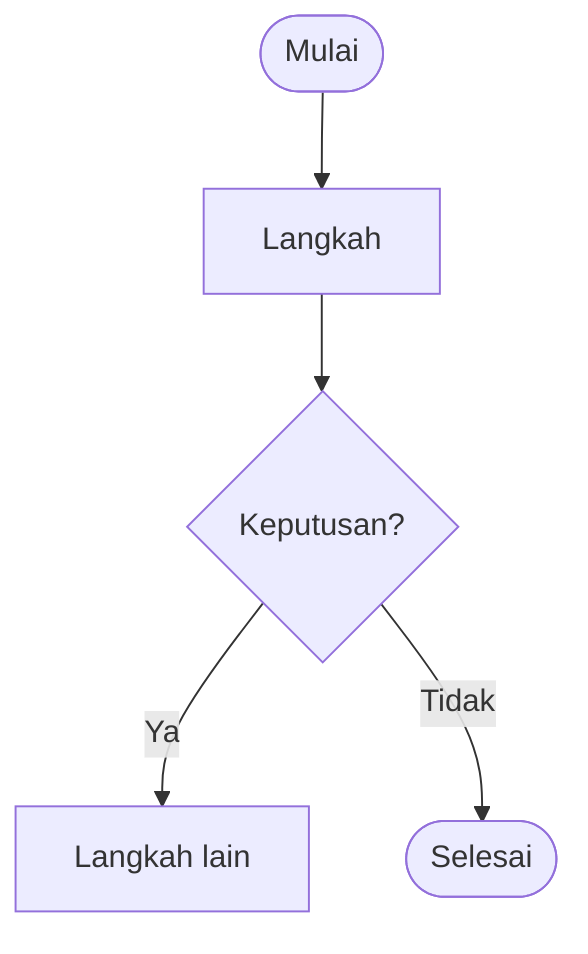

# Division Handbook — Gudang Teknik, PT Bakrie Pipe Industries

Website dokumentasi statis untuk peserta magang/PKL di Gudang Teknik (Warehouse) PT Bakrie Pipe Industries. Isinya: profil perusahaan (dengan sumber), pengenalan Gudang Teknik, alur kerja, tutorial, SOP draf, FAQ, glosarium, dan referensi.

> **Status: v0.2.1, sedang ditinjau pembimbing.** Alur barang masuk dan keluar sudah mengikuti alur asli Gudang Teknik. SOP selain penerimaan dan pengeluaran masih berupa panduan umum.
>
> **Versi online:** https://hwarinn66.github.io/WareHouse/ (GitHub Pages, diperbarui otomatis setiap ada push ke branch `main`). Situs memakai tag `noindex` agar tidak diindeks mesin pencari, tetapi tetap bisa dibuka siapa saja yang punya tautannya.

---

## Daftar isi

1. [Teknologi](#teknologi)
2. [Instalasi dan menjalankan secara lokal](#instalasi-dan-menjalankan-secara-lokal)
3. [Build dan deployment](#build-dan-deployment)
4. [Struktur proyek](#struktur-proyek)
5. [Mengelola isi](#mengelola-isi)
6. [Status halaman dan verifikasi](#status-halaman-dan-verifikasi)
7. [Informasi yang masih harus diverifikasi](#informasi-yang-masih-harus-diverifikasi)
8. [Checklist sebelum publikasi](#checklist-sebelum-publikasi)
9. [Ringkasan pengujian](#ringkasan-pengujian)

---

## Teknologi

| Bagian | Pilihan | Alasan |
| --- | --- | --- |
| Framework | [VitePress](https://vitepress.dev) 1.6 | Dibuat khusus untuk dokumentasi berbasis Markdown. Sidebar, daftar isi, navigasi sebelumnya/berikutnya, mode gelap, dan pencarian lokal sudah tersedia, sehingga isi mudah diedit oleh orang non-developer. Docusaurus juga cocok, tetapi lebih berat (React + MDX) untuk kebutuhan satu divisi. |
| Diagram | [Mermaid](https://mermaid.js.org) 12, dari paket lokal | Diagram ditulis sebagai teks di Markdown, sehingga mudah diubah tanpa aplikasi gambar. |
| Pencarian | Pencarian lokal VitePress (MiniSearch) | Indeks dibuat saat build. Tidak butuh server atau layanan luar. |
| Font | Plus Jakarta Sans (`@fontsource`) | Font yang ramah dan mudah dibaca. Disimpan lokal di hasil build, tidak memanggil Google Fonts. |
| Data | File JSON di `docs/data/` | FAQ, profil perusahaan, sumber, material, navigasi, dan isi beranda terpisah dari komponen tampilan. |

Tidak ada backend, database, login, API server, atau analitik.

## Instalasi dan menjalankan secara lokal

Prasyarat: **Node.js 18 atau lebih baru** (disarankan versi 22, lihat `.nvmrc`).

```bash
# 1. Masuk ke folder proyek
cd division-handbook

# 2. Pasang dependensi (sekali saja)
npm install

# 3. Jalankan mode pengembangan
npm run dev
```

Buka alamat yang muncul di terminal, biasanya `http://localhost:5173`. Setiap perubahan file langsung terlihat di browser.

## Build dan deployment

```bash
npm run build      # hasil di docs/.vitepress/dist/
npm run preview    # mencoba hasil build di http://localhost:4173
```

Folder `docs/.vitepress/dist/` berisi file statis (HTML, CSS, JS, gambar) yang bisa diunggah ke layanan static hosting mana pun.

| Hosting | Pengaturan |
| --- | --- |
| **Netlify / Vercel / Cloudflare Pages** | Build command: `npm run build`. Output directory: `docs/.vitepress/dist` |
| **GitHub Pages** (dipakai repo ini) | Otomatis lewat `.github/workflows/deploy.yml`: setiap push ke `main` menjalankan build dengan `BASE_PATH=/WareHouse/` lalu menerbitkan hasilnya ke branch `gh-pages`. Di **Settings → Pages**, sumbernya harus *Deploy from a branch* → `gh-pages` / `(root)`. Untuk build manual: `BASE_PATH=/nama-repo/ npm run build` |
| **Server internal perusahaan** (Nginx/Apache/IIS) | Salin isi `dist` ke folder web server. Atur agar alamat tanpa `.html` mengarah ke file `.html`, dan `404.html` dipakai untuk halaman tidak ditemukan |

> ⚠️ Versi di GitHub Pages bersifat publik. Sebelum handbook dinyatakan resmi, selesaikan [checklist publikasi](#checklist-sebelum-publikasi), terutama persetujuan pembimbing. Jika pembimbing meminta handbook tidak dibuka publik, nonaktifkan GitHub Pages di **Settings → Pages** dan jadikan repo private.

## Struktur proyek

```
division-handbook/
├── docs/                          ← semua isi website
│   ├── index.md                   ← Beranda
│   ├── mulai/                     ← Mulai dari Sini
│   ├── perusahaan/                ← Profil perusahaan
│   ├── divisi/                    ← Pengenalan Gudang Teknik, material, inventory, glosarium
│   ├── alur-kerja/                ← Barang masuk, barang keluar, stock opname, layout
│   ├── tutorial/                  ← Tutorial langkah demi langkah
│   ├── sop/                       ← SOP draf & K3
│   ├── tentang-handbook/          ← Cara memperbarui, verifikasi, checklist, riwayat versi
│   ├── faq.md, referensi.md
│   ├── data/                      ← DATA yang bisa diedit (JSON)
│   │   ├── navigasi.json          ← menu atas & sidebar
│   │   ├── beranda.json           ← isi Beranda
│   │   ├── company-profile.json   ← profil perusahaan + status verifikasi + sumber
│   │   ├── sumber.json            ← daftar referensi
│   │   ├── faq.json               ← FAQ
│   │   ├── alur.json              ← langkah alur barang masuk & keluar
│   │   ├── material.json          ← kelompok material
│   │   └── status.json            ← arti label status halaman
│   ├── public/                    ← file yang disalin apa adanya ke hasil build
│   │   └── images/                ← favicon, placeholder, (logo & gambar resmi nanti)
│   │       └── alur/              ← FOTO setiap kotak flowchart barang masuk & keluar
│   └── .vitepress/
│       ├── config.mts             ← konfigurasi situs (judul, pencarian, base path)
│       ├── search-extra.ts        ← memasukkan data JSON ke indeks pencarian
│       └── theme/                 ← tampilan (warna, layout, komponen Vue)
│           ├── custom.css         ← WARNA & tipografi (ubah di bagian :root)
│           ├── Layout.vue
│           └── components/        ← Beranda, FAQ, profil, breadcrumb, diagram, dll.
├── scripts/cek-publikasi.mjs      ← pemeriksaan sebelum publikasi
├── package.json
└── README.md
```

## Mengelola isi

Panduan lengkap dengan contoh juga tersedia di dalam website: **Tentang Handbook → Cara Memperbarui Handbook** (`docs/tentang-handbook/cara-memperbarui.md`).

### Menambah halaman

1. Buat file `.md` di folder yang sesuai, misalnya `docs/sop/pengembalian-barang.md`.
2. Isi frontmatter:

   ```yaml
   ---
   title: SOP Pengembalian Barang
   description: Ringkasan satu kalimat.
   status: draf                 # draf | ditinjau | disetujui | terverifikasi | perlu-verifikasi
   dasar: praktik umum pergudangan
   diperbarui: 2026-10-20
   kategori: SOP
   sumber: [ppt-gudang-teknik]  # id dari docs/data/sumber.json
   kata_kunci: [pengembalian, retur internal]
   ---
   ```

   Untuk SOP, isi juga `nomor_dokumen`, `versi`, `pemilik`, dan `pengesah` (untuk catatan pengelola, tidak ditampilkan).
3. Daftarkan di `docs/data/navigasi.json` (tanpa `.md`), misalnya `{ "text": "Pengembalian Barang", "link": "/sop/pengembalian-barang" }`.

Build akan **gagal** jika ada tautan internal di Markdown yang rusak. Ini disengaja agar tautan mati ketahuan sebelum dipublikasikan.

### Memperbarui FAQ dan metadata

- FAQ: `docs/data/faq.json`. Setiap pertanyaan berisi `id`, `tanya`, `jawab`, dan `status` (`terjawab` atau `menunggu-pembimbing`). Jawaban boleh memakai `**tebal**`, `*miring*`, `` `kode` ``, dan `[tautan](/halaman)`. Hanya pertanyaan berstatus `terjawab` yang tampil di website. FAQ yang tampil otomatis terindeks pencarian dan bisa ditautkan langsung (`/faq#id`).
- Metadata halaman: frontmatter di setiap file `.md` (lihat di atas). `kata_kunci` muncul sebagai tombol pencarian di bawah artikel dan ikut terindeks.

### Memperbarui profil perusahaan beserta sumbernya

1. Tambahkan sumber di `docs/data/sumber.json` (`id`, `judul`, `penerbit`, `jenis`, `url`, `tanggalTerbit`, `tanggalAkses`, `dipakaiUntuk`).
2. Di `docs/data/company-profile.json`, isi `nilai` bagian yang sesuai, ubah `status` menjadi `terverifikasi`, dan isi `sumber` dengan `id` tadi.
3. Bagian berstatus `perlu-verifikasi` **tidak** tampil sebagai fakta. Pengunjung hanya melihat keterangan bahwa informasi sedang dikonfirmasi.

Nomor rujukan `[1]`, `[2]`, … mengikuti urutan entri di `sumber.json`.

### Mengganti gambar dan logo

- Simpan gambar di `docs/public/images/` (huruf kecil, tanpa spasi, idealnya < 300 KB), lalu panggil dengan ``.
- Placeholder yang perlu diganti ada di `docs/public/images/placeholder/` dan dipakai di halaman Layout Gudang serta dua tutorial.
- **Logo perusahaan:** simpan file logo resmi sebagai `docs/public/images/logo-perusahaan.svg` (atau `.png`/`.webp`). Logo muncul otomatis di header setelah `npm run dev`/`build` dijalankan ulang. Logo **belum** disertakan karena file resmi dan izinnya belum tersedia.
- **Warna perusahaan:** ganti nilai `--bpi-*` di bagian `:root` (mode terang) dan `.dark` (mode gelap) pada `docs/.vitepress/theme/custom.css`. Warna saat ini adalah biru baja dan kuning marka lantai gudang sebagai pengganti sementara, **bukan** kode warna resmi.

> ⚠️ Semua file di `docs/public/` ikut ter-deploy dan bisa dibuka siapa saja yang tahu alamatnya, walaupun tidak ditautkan. Jangan menaruh dokumen internal, screenshot sistem, atau data pribadi di sana tanpa izin.

### Mengubah alur barang masuk / keluar

Alur ditampilkan sebagai flowchart (blok `mermaid` di `docs/alur-kerja/*.md`) dan sebagai daftar langkah (`docs/data/alur.json`). Jika urutan alur berubah, ubah keduanya. Warna kotak flowchart mengikuti pelakunya: tambahkan `:::vendor`, `:::staff`, `:::divisi`, `:::sistem`, `:::dokumen`, `:::cek`, `:::tolak`, atau `:::selesai` di belakang kotak. Warnanya diatur di `docs/.vitepress/theme/warnaAlur.ts`.

### Menambahkan foto alur barang masuk / keluar

Setiap kotak di flowchart barang masuk (10 kotak) dan barang keluar (11 kotak), termasuk kotak "Tidak" (dikembalikan/ditukar), punya tempat foto. Selama fotonya belum ada, yang tampil adalah placeholder "Foto belum ada".

1. Beri nama file: `barang-masuk-01.jpg` sampai `barang-masuk-10.jpg`, `barang-keluar-01.jpg` sampai `barang-keluar-11.jpg`. Untuk cabang "Tidak": `barang-masuk-02-tidak.jpg`, `barang-masuk-05-tidak.jpg`, dan `barang-keluar-11-tidak.jpg`. Format `.jpg`, `.jpeg`, `.png`, atau `.webp` bisa dipakai.
2. Taruh di `docs/public/images/alur/`.
3. Jalankan `npm run dev` untuk mengecek, lalu commit dan push. Website online terbarui otomatis.

Daftar lengkap nama file dan status fotonya (sudah ada atau belum) tampil di halaman **Untuk Pengelola → Cara Memperbarui Handbook**. Kotak bernomor di flowchart bisa diklik untuk melompat ke kartu fotonya.

> ⚠️ Pastikan foto boleh dipublikasikan: tidak memperlihatkan wajah orang tanpa izin, layar ERP, nomor dokumen, atau informasi rahasia.

### Menambah diagram

````md

````

Gunakan `flowchart TD` agar terbaca di ponsel, selalu isi `accTitle`/`accDescr`, dan tulis juga versi teks langkahnya di bawah diagram. Diagram dirender di browser. Jika penulisannya salah, halaman menampilkan pesan error beserta kodenya, jadi selalu cek tampilannya dengan `npm run dev`.

## Status halaman dan verifikasi

Setiap halaman punya `status` di frontmatter. Hanya `draf` dan `perlu-verifikasi` yang memunculkan catatan kecil di atas judul. Isi `catatan:` di frontmatter untuk mengganti teksnya, atau `catatan: false` untuk menyembunyikannya.

| Status | Arti | Dianggap siap publikasi? |
| --- | --- | --- |
| `disetujui` | Sudah diperiksa & disetujui pembimbing | Ya |
| `terverifikasi` | Fakta didukung sumber yang tercantum | Ya |
| `ditinjau` | Sedang diperiksa | Tidak |
| `draf` | Disusun dari materi/praktik umum, belum disahkan | Tidak |
| `perlu-verifikasi` | Sebagian isi belum dicocokkan dengan dokumen resmi | Tidak |

Rekap semua status bisa dilihat di halaman **Tentang Handbook → Informasi yang Perlu Diverifikasi**, atau dengan menjalankan:

```bash
npm run cek-publikasi          # laporan
npm run cek-publikasi:ketat    # gagal (exit 1) jika masih ada temuan
```

Skrip ini memeriksa status halaman, file berisiko di `docs/public/`, pola kata sandi/token, dan isi folder hasil build.

## Informasi yang masih harus diverifikasi

Daftar lengkap ada di `docs/tentang-handbook/perlu-verifikasi.md`. Ringkasnya:

**Perusahaan:** visi & misi resmi · tahun berdiri & sejarah · apakah *Passion, Respect, Integrity, Discipline, Excellent* nilai resmi perusahaan atau moto unit · jenis/ukuran/standar produk · struktur organisasi · sertifikasi yang berlaku · alamat situs resmi.

**Gudang Teknik:** denah layout gudang (slide 7) · kepanjangan "OS" pada OS/PPIC · format surat tanda terima dan laporan ke OS/PPIC · bagian ERP yang boleh diakses peserta magang · aturan pengodean barang · parameter stok min/maks/ROP · kategori material tanpa permintaan · jadwal stock opname · siapa yang memesan barang ke vendor.

**SOP & K3:** SOP resmi yang ada · APD wajib · area terbatas · nomor darurat, APAR, P3K, jalur evakuasi, titik kumpul · aturan limbah consumable.

**Magang & publikasi:** jam kerja/absensi/izin · izin logo & warna (beserta file logo dan kode warnanya) · izin publikasi · foto/screenshot yang boleh dimuat.

## Checklist sebelum publikasi

1. [ ] Persetujuan tertulis pembimbing atau penanggung jawab, termasuk ke mana website boleh dipublikasikan.
2. [ ] Informasi perusahaan diperiksa dan semua sumber bisa dibuka.
3. [ ] Visi, misi, dan bidang usaha sesuai dokumen resmi, atau tidak ditampilkan.
4. [ ] SOP dan prosedur keselamatan diperiksa. Tidak ada ketentuan K3 resmi yang dikurangi.
5. [ ] Semua gambar, screenshot, dan dokumen sudah diizinkan.
6. [ ] Data sensitif dihapus: data karyawan/supplier/harga/stok asli, kredensial, denah keamanan.
7. [ ] Penggunaan logo dan identitas perusahaan disetujui.
8. [ ] Semua URL dan file yang ikut ter-deploy diperiksa (`npm run build` lalu `npm run cek-publikasi:ketat`).

Lalu, hanya jika memang boleh tampil di mesin pencari, hapus meta `robots: noindex` di `docs/.vitepress/config.mts`, dan sesuaikan teks status di `footer`.

## Ringkasan pengujian

Pengujian yang **benar-benar dijalankan** pada versi 0.2.0 (13 Oktober 2026), menggunakan Chromium headless (Playwright) terhadap hasil `npm run build` yang disajikan `vitepress preview`:

| Pengujian | Hasil |
| --- | --- |
| `npm run build` | Berhasil tanpa error, 33 halaman HTML |
| Pemeriksaan tautan internal dan anchor `#` di semua HTML hasil build | 1.596 tautan, 0 rusak, 0 anchor hilang |
| Semua halaman sidebar + halaman 404 di lebar 1440, 1024, 768, dan 375 px (132 kombinasi) | Tidak ada scroll horizontal, gambar gagal, error console, request gagal, atau flowchart gagal. Setiap halaman punya tepat satu `<h1>` |
| Flowchart (alur warehouse, barang masuk, barang keluar, dll.) | Semua tampil di mode terang dan gelap. Tombol "Lihat ukuran besar" membuka dan menutup (Esc) |
| Flowchart bergambar | Barang masuk 10 kartu dan barang keluar 11 kartu, masing-masing dengan tempat foto. Kotak flowchart bernomor bisa diklik untuk melompat ke kartunya. Foto uji yang ditaruh di `images/alur/` tampil otomatis, lalu dihapus lagi |
| Pencarian lokal | "rak reservasi", "ERP", "surat tanda terima", dan "bearing" menemukan hasil yang relevan. Kata acak menampilkan pesan "Belum ketemu" beserta saran kata |
| Beranda | Tombol "Coba cari" mengisi kata kunci, kartu topik membuka halaman tujuan |
| FAQ | 18 pertanyaan tampil, yang belum terjawab tersembunyi. Buka/tutup dengan klik dan Enter, terbuka otomatis dari tautan `#id` |
| Profil perusahaan | Data yang belum terverifikasi tidak tampil |
| Tablet 768–1023 px | Menu atas pindah ke tombol hamburger. Di 1024 px ke atas, menu tampil normal |
| Ponsel 375 px | Sidebar terbuka lewat tombol Menu, pencarian terbuka |

**Belum diuji / kendala yang tersisa**

- Belum diuji di Safari/iOS, Firefox, dan perangkat fisik. Pengujian hanya memakai Chromium.
- Belum ada audit aksesibilitas otomatis (axe/Lighthouse) maupun uji dengan pembaca layar.
- Logo dan warna resmi perusahaan belum diterapkan karena file logo dan kode warnanya belum tersedia.
- Denah layout gudang masih placeholder.
- Library Mermaid cukup besar. Halaman yang memiliki flowchart memuat sekitar 2,7 MB (sebelum kompresi server). Mermaid hanya dimuat di halaman yang memiliki flowchart.
