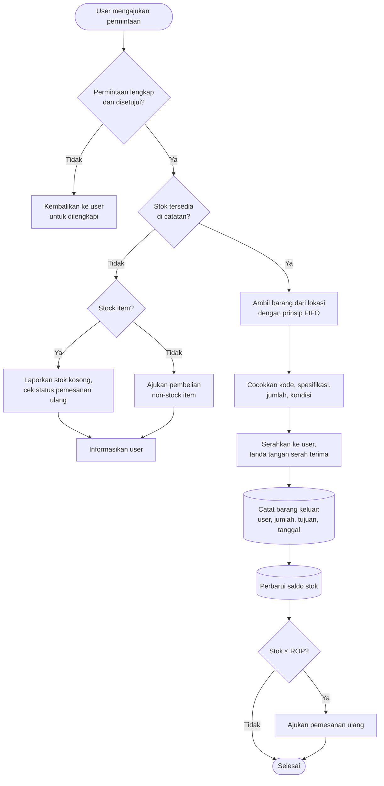

# Alur Barang Keluar

Alur ini memastikan user menerima barang yang benar, dalam jumlah dan kondisi yang tepat, dan setiap pengeluaran tercatat sehingga stok bisa dipantau.

## Ringkasan proses

| | |
| --- | --- |
| **Tujuan** | Memenuhi permintaan user dengan tepat (prinsip 4 right) dan mencatat pemakaiannya |
| **Pemicu** | User mengajukan permintaan atau reservasi material |
| **Pihak yang terlibat** | User, pihak yang menyetujui permintaan, petugas Gudang Teknik, bagian pembelian (jika stok perlu dipesan ulang) |
| **Input** | Permintaan berisi user, kode atau nama barang, jumlah, tujuan pemakaian, tanggal |
| **Output** | Barang diserahkan, catatan barang keluar, saldo berkurang, pengajuan pemesanan ulang bila perlu |
| **SOP terkait** | [Pengeluaran Barang](/sop/pengeluaran-barang) |

## Diagram

## Langkah tertulis

1. **Terima permintaan dari user.** Pastikan permintaan memuat nama user, kode atau nama barang, jumlah, tujuan pemakaian, dan tanggal.
2. **Periksa kelengkapan dan persetujuan.** Permintaan yang belum lengkap atau belum disetujui dikembalikan ke user.
3. **Cek ketersediaan stok** di catatan.
   - Jika **kosong** dan barangnya stock item, laporkan ke pembimbing dan cek apakah pemesanan ulang sudah berjalan.
   - Jika **kosong** dan barangnya non-stock item, ajukan pembelian sesuai prosedur.
   - Sampaikan ke user bahwa barang belum tersedia.
4. **Ambil barang** dari lokasinya. Dahulukan barang yang masuk lebih awal (FIFO).
5. **Verifikasi** kode, spesifikasi, jumlah, dan kondisi barang sebelum diserahkan.
6. **Serahkan barang ke user** dan minta tanda tangan serah terima.
7. **Catat barang keluar**: user, jumlah, tujuan, dan tanggal.
8. **Perbarui saldo stok.**
9. **Bandingkan saldo dengan ROP.** Jika saldo sudah sama dengan atau di bawah ROP, ajukan pemesanan ulang.

## Potensi kesalahan

- **Menyerahkan barang tanpa catatan**, misalnya karena user terburu-buru. Stok di catatan menjadi lebih besar dari fisik.
- **Salah ambil barang yang mirip**, misalnya bearing dengan ukuran berbeda. Selalu cocokkan kode dan spesifikasi.
- **Tidak menerapkan FIFO.** Barang lama tertinggal dan berisiko menjadi dead stock.
- **Lupa memeriksa ROP.** Stok baru disadari habis saat ada permintaan berikutnya.
- **Mencatat tujuan pemakaian secara asal.** Data tujuan dipakai untuk menganalisis pemakaian, jadi tulis dengan jelas.
