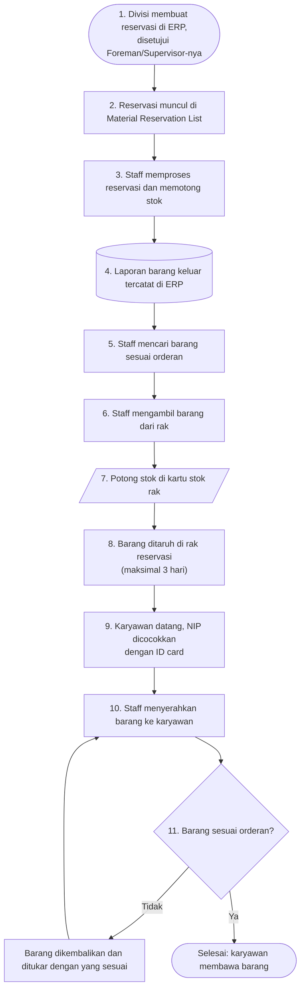

# Alur Barang Keluar

Alur ini dimulai saat divisi lain memesan barang lewat ERP dan selesai saat karyawan divisi tersebut membawa barangnya. Barang disiapkan dulu di rak reservasi sebelum diambil.

## Flowchart

<LegendaAlur />

## Langkah demi langkah dengan foto

Setiap kotak di flowchart punya kartu bernomor yang sama di bawah ini, lengkap dengan fotonya.

<LangkahAlur alur="barang-keluar" />

## Hal yang sering terlewat

- **Mengambil barang yang mirip tetapi beda tipe.** Selalu cocokkan kode dan spesifikasi dengan orderan di ERP.
- **Lupa mencatat di catatan manual rak.** Jumlah di rak dan di ERP jadi tidak sama.
- **Barang di rak reservasi tidak diberi keterangan.** Tandai untuk divisi atau orderan mana barang itu, agar tidak tertukar.
- **Menyerahkan tanpa dicek bersama.** Minta karyawan mengecek barang saat itu juga, supaya kesalahan langsung ketahuan.
- **Tidak mencocokkan NIP.** Barang hanya diserahkan ke karyawan yang NIP-nya tercantum di reservasi.
- **Barang reservasi dibiarkan lebih dari 3 hari.** Reservasinya batal, dan barang harus dikembalikan ke stok.

Langkah kerja yang lebih rinci ada di [SOP Pengeluaran Barang](/sop/pengeluaran-barang).
