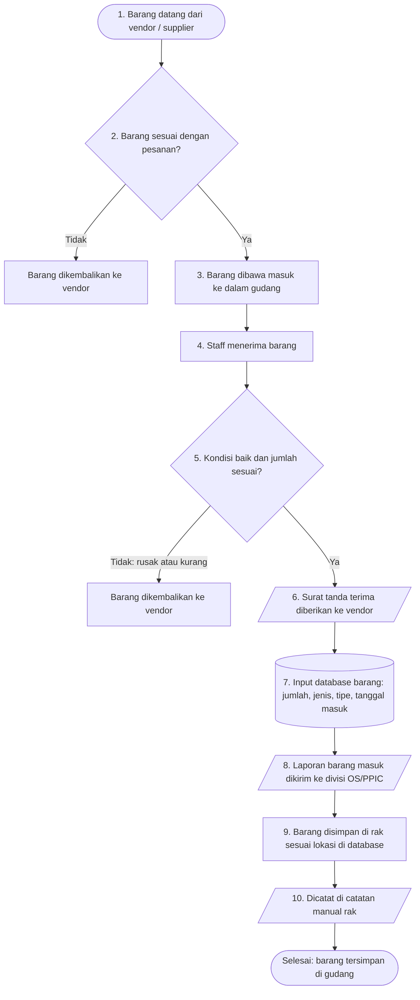

# Alur Barang Masuk

Alur ini dimulai saat vendor mengantar barang dan selesai saat barang tersimpan di rak. Ada dua kali pengecekan. Jika barang tidak lolos salah satunya, barang dikembalikan ke vendor.

## Flowchart

<LegendaAlur />

## Langkah demi langkah dengan foto

Setiap kotak di flowchart punya kartu bernomor yang sama di bawah ini, lengkap dengan fotonya.

<LangkahAlur alur="barang-masuk" />

## Hal yang sering terlewat

- **Menerima barang tanpa mengecek.** Cek dulu sebelum surat tanda terima diberikan. Setelah surat diserahkan, kekurangan barang jadi sulit diklaim.
- **Lupa input database.** Barang sudah ada di rak tetapi tidak tercatat, sehingga terlihat seperti stok kosong.
- **Lokasi rak tidak sesuai database.** Barang jadi sulit ditemukan saat ada permintaan.
- **Lupa mengisi catatan manual di rak.** Catatan di rak dan database jadi tidak sama.

Langkah kerja yang lebih rinci ada di [SOP Penerimaan Barang](/sop/penerimaan-barang).
