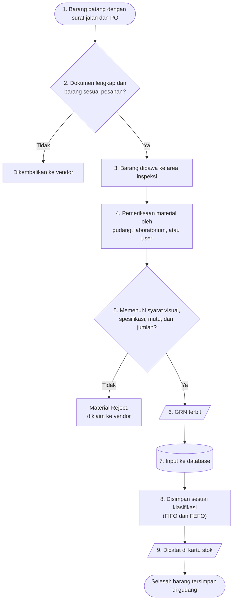

# Alur Barang Masuk

Alur ini dimulai saat vendor mengantar barang dan selesai saat barang tersimpan di rak. Urutannya mengikuti Instruksi Kerja Penerimaan Material Gudang Teknik. Ada dua kali pengecekan: dokumen dan pesanan saat barang datang, lalu hasil pemeriksaan material di area inspeksi.

## Flowchart

<LegendaAlur />

## Langkah demi langkah dengan foto

Setiap kotak di flowchart punya kartu bernomor yang sama di bawah ini, lengkap dengan fotonya.

<LangkahAlur alur="barang-masuk" />

## Hal yang sering terlewat

- **Menerbitkan GRN sebelum barang dicek.** Periksa dulu sampai tuntas. Setelah GRN terbit, kekurangan barang jadi sulit diklaim.
- **Memindahkan barang dari area inspeksi terlalu cepat.** Barang baru boleh dipindahkan setelah dinyatakan sesuai.
- **Barang tidak sesuai tidak diberi tanda.** Barang yang ditolak harus dipisahkan dan diberi tanda Material Reject, supaya tidak tercampur dengan stok.
- **Lupa input ke database.** Barang sudah ada di rak tetapi tidak tercatat, sehingga terlihat seperti stok kosong.
- **Lokasi rak tidak sesuai database.** Barang jadi sulit ditemukan saat ada permintaan.
- **Lupa mengisi kartu stok di rak.** Catatan di rak dan database jadi tidak sama.

Langkah kerja yang lebih rinci ada di [SOP Penerimaan Barang](/sop/penerimaan-barang).
