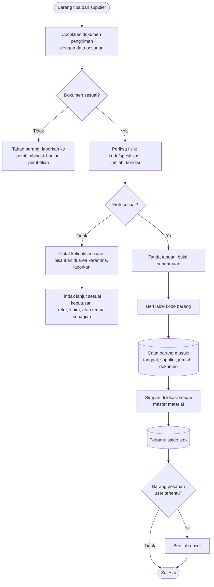

# Alur Barang Masuk

Alur ini memastikan setiap barang yang masuk ke gudang benar jenisnya, benar jumlahnya, layak kondisinya, lalu tersimpan di tempat yang tepat dan tercatat.

## Ringkasan proses

| | |
| --- | --- |
| **Tujuan** | Menerima material yang sesuai pesanan dan mencatatnya dengan benar |
| **Pemicu** | Barang dan dokumen pengiriman tiba dari supplier |
| **Pihak yang terlibat** | Supplier, petugas Gudang Teknik, bagian pembelian, user (untuk barang pesanan khusus) |
| **Input** | Barang fisik, dokumen pengiriman, data pesanan |
| **Output** | Barang tersimpan di lokasinya, catatan barang masuk (tanggal, supplier, jumlah, dokumen), saldo stok bertambah |
| **SOP terkait** | [Penerimaan Barang](/sop/penerimaan-barang), [Penyimpanan Barang](/sop/penyimpanan-barang) |

## Diagram

## Langkah tertulis

1. **Terima kedatangan barang.** Pastikan barang datang bersama dokumen pengirimannya.
2. **Cocokkan dokumen.** Bandingkan dokumen pengiriman dengan data pesanan: nama barang, kode atau spesifikasi, dan jumlah.
   - Jika dokumen **tidak sesuai** atau tidak ada, tahan barangnya dan laporkan ke pembimbing serta bagian pembelian. Jangan dicatat sebagai barang masuk.
3. **Periksa fisik barang.** Hitung jumlahnya, cocokkan spesifikasi atau part number, dan periksa kondisinya (kemasan rusak, karat, cacat).
   - Jika fisik **tidak sesuai**, catat ketidaksesuaiannya, pisahkan barang di area karantina, lalu laporkan. Keputusan retur, klaim, atau penerimaan sebagian diambil oleh pihak yang berwenang.
4. **Tanda tangani bukti penerimaan** hanya untuk barang yang sudah diperiksa dan sesuai.
5. **Beri label** berisi kode barang agar mudah diidentifikasi.
6. **Catat barang masuk**: tanggal, supplier, jumlah, dan nomor dokumen.
7. **Simpan di lokasi** sesuai master material. Letakkan barang baru di belakang atau di bawah barang lama agar FIFO berjalan.
8. **Perbarui saldo stok**, lalu arsipkan dokumennya.
9. **Beri tahu user** jika barang tersebut dipesan khusus untuknya (non-stock item).

## Potensi kesalahan

- **Menandatangani sebelum memeriksa.** Begitu bukti penerimaan ditandatangani, klaim kekurangan jadi sulit.
- **Hanya menghitung kemasan.** Satu dus belum tentu berisi jumlah yang tertulis. Periksa isinya jika memungkinkan.
- **Salah satuan.** Misalnya dokumen dalam "set", tetapi dicatat dalam "pcs".
- **Barang baru diletakkan di depan barang lama.** Akibatnya FIFO tidak berjalan dan barang lama berisiko kedaluwarsa.
- **Menunda pencatatan.** Saldo menjadi tidak akurat dan barang bisa dianggap belum datang.
