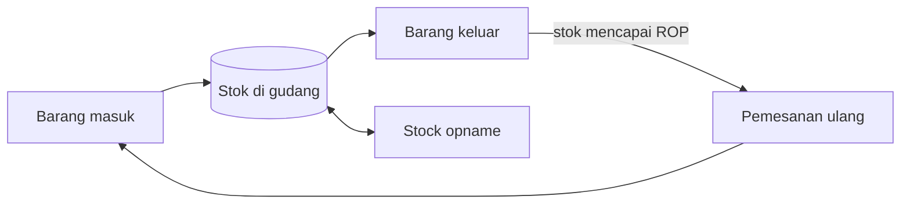

# Ringkasan Alur Kerja

Tiga alur ini adalah inti pekerjaan Gudang Teknik. Setiap halaman memuat diagram, langkah tertulis, titik keputusan, dan kesalahan yang perlu dihindari.

| Alur | Dipicu oleh | Hasil akhir | Status diagram |
| --- | --- | --- | --- |
| [Barang masuk](./barang-masuk) | Barang tiba dari supplier | Barang tersimpan dan tercatat | Draf, perlu dicocokkan dengan slide 5 |
| [Barang keluar](./barang-keluar) | Permintaan dari user | Barang diserahkan dan tercatat | Draf, perlu dicocokkan dengan slide 6 |
| [Stock opname](./stock-opname) | Jadwal penghitungan | Selisih teridentifikasi dan dilaporkan | Draf |
| [Layout gudang](./layout-gudang) | — | Denah lokasi penyimpanan | Menunggu gambar slide 7 |

::: warning Diagram masih draf
Urutan langkah di bagian ini disusun dari praktik umum pergudangan dan data yang disebut di materi Gudang Teknik (misalnya tanggal, supplier, jumlah, dan dokumen untuk barang masuk). Sebelum dipakai sebagai pegangan, cocokkan dengan gambar alur di presentasi asli dan minta persetujuan pembimbing.
:::

## Cara membaca diagram

- **Kotak** adalah langkah kerja.
- **Belah ketupat** adalah titik keputusan. Ikuti panah "Ya" atau "Tidak".
- **Silinder** adalah tempat data disimpan, misalnya catatan stok.
- Di layar kecil, ketuk **Perbesar diagram** untuk melihat diagram dalam ukuran penuh, lalu geser untuk membaca.
- Setiap diagram punya versi tertulis di bawahnya. Versi tertulis itulah yang dipakai jika diagram sulit dibaca.
