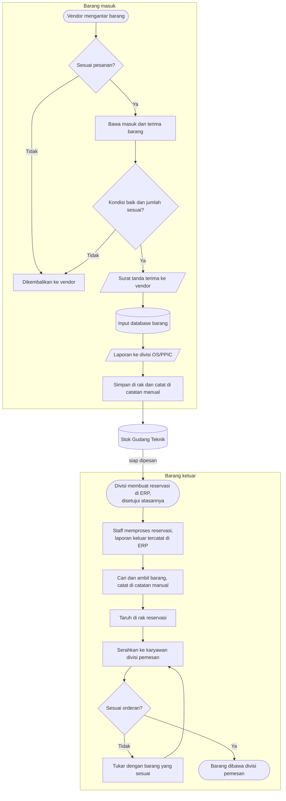

# Alur Warehouse

Pekerjaan Gudang Teknik terdiri dari dua alur utama: <strong>barang masuk</strong> dari vendor dan <strong>barang keluar</strong> ke divisi yang membutuhkan. Keduanya bertemu di stok gudang.

## Flowchart lengkap

<LegendaAlur />

## Pelajari per bagian

<DaftarKartu :items="[
  { judul: 'Alur barang masuk', ket: 'Dari vendor datang sampai barang tersimpan di rak.', link: '/alur-kerja/barang-masuk', ikon: 'masuk' },
  { judul: 'Alur barang keluar', ket: 'Dari permintaan di ERP sampai barang diambil divisi.', link: '/alur-kerja/barang-keluar', ikon: 'keluar' },
  { judul: 'Stock opname', ket: 'Menghitung stok fisik dan mencocokkannya dengan catatan.', link: '/alur-kerja/stock-opname', ikon: 'opname' },
  { judul: 'Layout gudang', ket: 'Denah area dan rak penyimpanan.', link: '/alur-kerja/layout-gudang', ikon: 'denah' }
]" />

## Tiga hal yang selalu dicatat

Setiap barang yang bergerak meninggalkan jejak di tiga tempat. Ketiganya harus selalu cocok.

1. **Database / ERP.** Barang masuk diinput ke database, dan barang keluar tercatat di ERP saat staff menyetujui permintaan.
2. **Catatan manual di rak.** Setiap barang yang ditaruh atau diambil dari rak dicatat di catatan yang ada di rak itu.
3. **Laporan.** Laporan barang masuk dikirim ke divisi OS/PPIC, sedangkan laporan barang keluar tersimpan di ERP.
