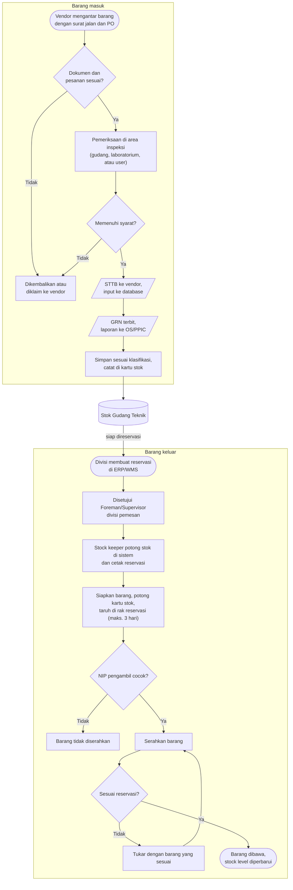

# Alur Warehouse

Pekerjaan Gudang Teknik terdiri dari dua alur utama: <strong>barang masuk</strong> dari vendor dan <strong>barang keluar</strong> ke divisi yang membutuhkan. Keduanya bertemu di stok gudang.

## Flowchart lengkap

<LegendaAlur />

## Pelajari per bagian

<DaftarKartu :items="[
  { judul: 'Alur barang masuk', ket: 'Dari vendor datang sampai barang tersimpan di rak.', link: '/alur-kerja/barang-masuk', ikon: 'masuk' },
  { judul: 'Alur barang keluar', ket: 'Dari reservasi di ERP sampai barang diambil divisi.', link: '/alur-kerja/barang-keluar', ikon: 'keluar' },
  { judul: 'Stock opname', ket: 'Menghitung stok fisik setiap hari secara bergilir.', link: '/alur-kerja/stock-opname', ikon: 'opname' },
  { judul: 'Layout gudang', ket: 'Denah area dan rak penyimpanan.', link: '/alur-kerja/layout-gudang', ikon: 'denah' }
]" />

## Tiga hal yang selalu dicatat

Setiap barang yang bergerak meninggalkan jejak di tiga tempat. Ketiganya harus selalu cocok.

1. **Sistem ERP/WMS.** Barang masuk diinput lewat STTB, dan stok barang keluar dipotong di sistem saat reservasi diproses.
2. **Kartu stok di rak.** Setiap barang yang ditaruh atau diambil dari rak dicatat di kartu stok (catatan manual) di rak itu, lengkap dengan saldo akhirnya.
3. **Dokumen.** Barang masuk punya STTB dan GRN (laporannya juga diteruskan ke divisi OS/PPIC), sedangkan barang keluar punya reservasi yang dicetak.
