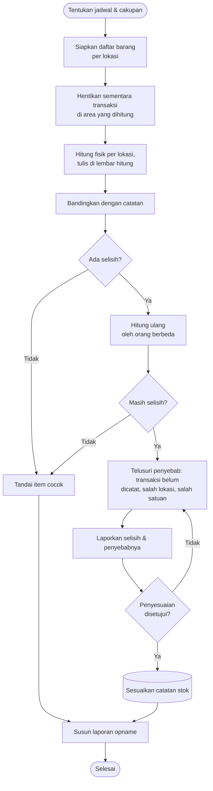

# Alur Stock Opname

Stock opname membandingkan jumlah barang di rak dengan jumlah di catatan. Tujuannya menemukan selisih, mencari penyebabnya, lalu memperbaiki catatan secara sah.

## Ringkasan proses

| | |
| --- | --- |
| **Tujuan** | Menjaga akurasi stok (stock accuracy) |
| **Pemicu** | Jadwal opname rutin, cycle counting per kelompok, atau temuan selisih |
| **Pihak yang terlibat** | Petugas penghitung, pemeriksa, pembimbing atau atasan gudang (penyetuju penyesuaian) |
| **Input** | Daftar barang dan lokasi dari catatan, alat tulis atau lembar hitung |
| **Output** | Lembar hasil hitung, daftar selisih beserta penyebabnya, laporan opname |
| **SOP terkait** | [Stock Opname](/sop/stock-opname) |

## Diagram

## Langkah tertulis

1. **Tentukan jadwal dan cakupan.** Bisa seluruh gudang, atau sebagian secara bergiliran (*cycle counting*).
2. **Siapkan daftar barang per lokasi** dari catatan.
3. **Hentikan sementara transaksi** di area yang dihitung. Jika tidak memungkinkan, catat waktu batasnya (*cut-off*) agar transaksi setelahnya tidak tercampur.
4. **Hitung fisik per lokasi.** Tulis hasilnya apa adanya, termasuk barang rusak dan barang tanpa label.
5. **Bandingkan** hasil hitung dengan catatan.
6. **Jika ada selisih, hitung ulang** sebaiknya oleh orang lain.
7. **Telusuri penyebab** selisih yang tetap ada: transaksi yang belum dicatat, barang di lokasi lain, salah satuan, atau salah kode.
8. **Laporkan** selisih dan penyebabnya. Catatan stok hanya disesuaikan setelah disetujui pihak berwenang.
9. **Susun laporan opname**, termasuk temuan lain seperti barang rusak, label hilang, atau calon dead stock.

## Potensi kesalahan

- **Menghitung sambil ada transaksi berjalan.** Hasilnya tidak bisa dibandingkan dengan catatan.
- **Langsung mengubah angka di catatan agar cocok.** Penyebab selisih tidak pernah ditemukan dan bisa terulang.
- **Melewatkan lokasi cadangan**, misalnya barang yang sama disimpan di dua rak.
- **Tidak mencatat kondisi barang.** Barang rusak ikut terhitung sebagai stok yang siap pakai.
