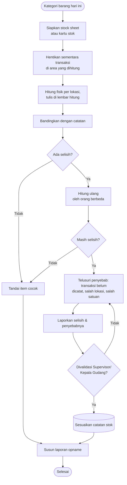

# Alur Stock Opname

Stock opname membandingkan jumlah barang di rak dengan jumlah di catatan. Di Gudang Teknik, stock opname dilakukan setiap hari secara bergilir (<em>cycle count</em>). Tujuannya menemukan selisih, mencari penyebabnya, lalu memperbaiki catatan secara sah.

## Ringkasan proses

| | |
| --- | --- |
| **Tujuan** | Menjaga akurasi stok (stock accuracy) |
| **Pemicu** | Jadwal harian bergilir per kategori barang, terutama fast moving, barang bernilai tinggi, dan barang yang baru masuk atau keluar |
| **Pihak yang terlibat** | Stock Keeper (menghitung) dan Supervisor atau Kepala Gudang (memvalidasi) |
| **Input** | Stock sheet harian atau kartu stok, alat tulis, dan clipboard |
| **Output** | Lembar hasil hitung, daftar selisih beserta penyebabnya, laporan opname |
| **SOP terkait** | [Stock Opname](/sop/stock-opname) |

## Diagram

## Langkah tertulis

1. **Lihat jadwal hari ini.** Setiap hari, kategori barang yang berbeda dihitung secara bergiliran (*cycle count*), dengan fokus pada barang fast moving, barang bernilai tinggi, dan barang yang baru masuk atau keluar.
2. **Siapkan stock sheet harian atau kartu stok** untuk kategori tersebut.
3. **Hentikan sementara transaksi** di area yang dihitung. Jika tidak memungkinkan, catat waktu batasnya (*cut-off*) agar transaksi setelahnya tidak tercampur.
4. **Hitung fisik per lokasi.** Tulis hasilnya apa adanya, termasuk barang rusak dan barang tanpa label.
5. **Bandingkan** hasil hitung dengan catatan.
6. **Jika ada selisih, hitung ulang** sebaiknya oleh orang lain.
7. **Telusuri penyebab** selisih yang tetap ada: transaksi yang belum dicatat, barang di lokasi lain, salah satuan, atau salah kode.
8. **Laporkan** selisih dan penyebabnya ke Supervisor atau Kepala Gudang. Catatan stok hanya disesuaikan setelah hasilnya divalidasi.
9. **Susun laporan opname**, termasuk temuan lain seperti barang rusak, label hilang, atau calon barang write off.

## Potensi kesalahan

- **Menghitung sambil ada transaksi berjalan.** Hasilnya tidak bisa dibandingkan dengan catatan.
- **Langsung mengubah angka di catatan agar cocok.** Penyebab selisih tidak pernah ditemukan dan bisa terulang.
- **Melewatkan lokasi cadangan**, misalnya barang yang sama disimpan di dua rak.
- **Tidak mencatat kondisi barang.** Barang rusak ikut terhitung sebagai stok yang siap pakai.
