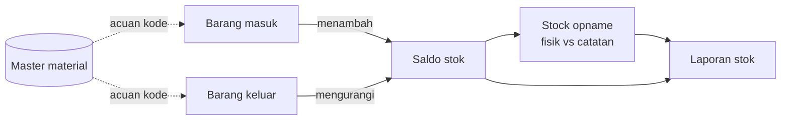

# Administrasi & Kontrol Stok

Dokumen dan data harus mendukung kondisi fisik di lapangan. Jika catatan dan barang di rak tidak sama, gudang tidak bisa diandalkan.

## Lima catatan utama

| Catatan | Isi | Hasilnya |
| --- | --- | --- |
| **Master material** | Kode, nama, spesifikasi, satuan, lokasi | Identitas material yang konsisten |
| **Barang masuk** | Tanggal, supplier, jumlah, dokumen | Riwayat penerimaan |
| **Barang keluar** | User, jumlah, tujuan, tanggal | Riwayat pemakaian |
| **Stock opname** | Hitungan fisik dibandingkan catatan sistem | Selisih yang teridentifikasi |
| **Laporan stok** | Saldo, mutasi, stok minimum | Dasar pengambilan keputusan |

## Bagaimana catatan saling terhubung

Rumus dasarnya:

> **Saldo akhir = saldo awal + total barang masuk − total barang keluar**

Jika saldo akhir di catatan berbeda dengan hasil hitung fisik, ada transaksi yang belum tercatat, salah catat, atau barang yang berpindah tanpa catatan.

## Kebiasaan yang menjaga catatan tetap akurat

- **Catat saat itu juga.** Jangan menunda pencatatan sampai akhir hari.
- **Satu transaksi, satu dokumen.** Setiap barang masuk atau keluar harus punya bukti.
- **Gunakan kode, bukan nama.** Nama bisa ditulis berbeda-beda, sedangkan kode tidak.
- **Kembalikan barang ke lokasinya.** Barang yang dipindahkan tanpa catatan sama saja dengan hilang.
- **Laporkan selisih, jangan mengubah angka sendiri.** Penyesuaian stok harus melalui persetujuan.

## Mengukur akurasi stok

Salah satu indikator gudang yang baik adalah **stock accuracy**, yaitu kesesuaian stok fisik dengan catatan sistem. Cara umum menghitungnya:

> **Akurasi stok (%) = jumlah item yang cocok ÷ jumlah item yang dihitung × 100**

Contoh latihannya ada di tutorial [Mencatat Hasil Hitung Fisik](/tutorial/hitung-fisik).
