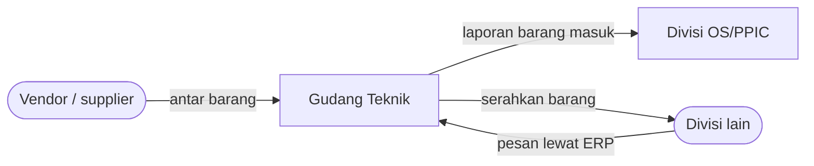

# Kenali Gudang Teknik

Gudang Teknik (warehouse) adalah tempat barang teknik diterima, disimpan, dirawat, dan disalurkan untuk mendukung kegiatan operasional perusahaan.

Moto gudang ini adalah ***A place for everything and everything in its place***. Artinya, setiap barang punya tempatnya sendiri, dan setiap barang harus ada di tempatnya.

## Barang apa saja yang ada di sini?

Barang pendukung produksi dan perbaikan mesin, misalnya spare part mesin, komponen mekanik, alat kerja teknisi, baut, mur, bearing, bahan perawatan, dan ATK. Daftar lengkapnya ada di [Jenis Material](./jenis-material).

## Tiga fungsi utama

<DaftarKartu :items="[
  { judul: 'Penyimpanan', ket: 'Menjaga barang tetap rapi, aman, mudah dicari, dan tidak rusak.', link: '/sop/penyimpanan-barang', ikon: 'kotak' },
  { judul: 'Pengendalian', ket: 'Mencatat barang masuk, lokasi, jumlah stok, dan barang keluar.', link: '/divisi/administrasi-stok', ikon: 'daftar' },
  { judul: 'Pelayanan', ket: 'Memastikan barang yang dibutuhkan divisi lain tersedia.', link: '/alur-kerja/barang-keluar', ikon: 'keluar' }
]" :kolom="1" />

## Prinsip 4 right

Setiap kali melayani permintaan, pastikan empat hal ini terpenuhi:

| | Artinya |
| --- | --- |
| **Right material** | Barangnya benar, sesuai kode dan spesifikasi. |
| **Right quantity** | Jumlahnya tepat, tidak kurang dan tidak lebih. |
| **Right condition** | Kondisinya baik dan siap dipakai. |
| **Right time** | Tersedia tepat waktu saat dibutuhkan. |

## Dengan siapa gudang bekerja?

- **Vendor / supplier** mengantar barang yang dipesan.
- **Divisi OS/PPIC** menerima laporan bahwa barang sudah masuk dan sesuai.
- **Divisi lain** memesan barang lewat ERP, lalu karyawannya datang mengambil barang di gudang.

Urutan lengkapnya ada di [Alur Warehouse](/alur-kerja/).

## Ukuran gudang yang baik

| | Artinya |
| --- | --- |
| **Order fulfillment** | Permintaan dipenuhi dengan tepat. |
| **On-time** | Barang tersedia tepat waktu. |
| **Space utilization** | Ruang gudang dipakai dengan efisien. |
| **Stock accuracy** | Jumlah barang di rak sama dengan catatan. |

## Yang perlu kamu kuasai

Setelah beberapa minggu magang, kamu diharapkan bisa:

- Mengenali kelompok barang dan contohnya.
- Membaca kode barang dan mencocokkannya dengan barang aslinya.
- Mengikuti alur barang masuk dan barang keluar.
- Mengisi catatan manual di rak dengan benar.
- Mengambil barang dengan prinsip FIFO.
- Bekerja dengan aman dan memakai APD.

Ada istilah yang belum kamu pahami? Buka [Kamus Istilah](./glosarium).
