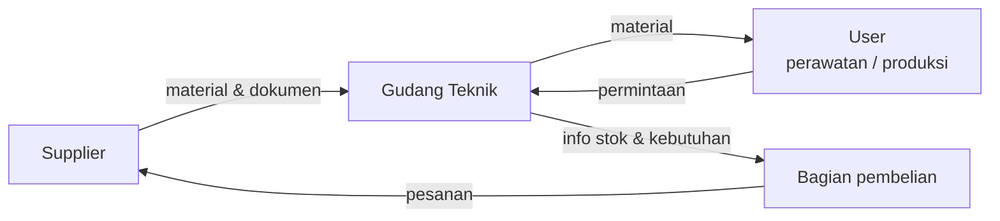

# Pengenalan Gudang Teknik

Gudang Teknik (warehouse) adalah tempat barang teknik diterima, disimpan, dikelola, dipelihara, dan disalurkan untuk mendukung kegiatan operasional perusahaan.

Moto unit ini adalah ***A place for everything and everything in its place***: setiap barang punya tempat, dan setiap barang berada di tempatnya.

## Barang yang dikelola

Barang di Gudang Teknik adalah kebutuhan pendukung produksi dan perbaikan mesin. Contohnya ATK, spare part mesin, komponen mekanik, peralatan teknisi (*tools*), material perawatan, baut, mur, dan bearing. Daftar lengkap per kelompok ada di [Jenis Material](./jenis-material).

## Tiga fungsi utama

| Fungsi | Artinya dalam pekerjaan sehari-hari |
| --- | --- |
| **Penyimpanan** | Menjaga material tetap teratur, aman, mudah ditemukan, dan terlindungi dari kerusakan. |
| **Pengendalian** | Mencatat penerimaan, lokasi, stok, perpindahan, dan pengeluaran material. |
| **Pelayanan** | Memastikan kebutuhan material untuk operasional dan perawatan (*maintenance*) dapat dipenuhi. |

## Prinsip 4 right

Gudang yang baik memastikan empat hal ini terpenuhi setiap kali melayani permintaan:

- **Right material.** Barang yang diserahkan sesuai kode dan spesifikasi yang diminta.
- **Right quantity.** Jumlahnya tepat, tidak kurang dan tidak lebih.
- **Right condition.** Kondisinya baik dan layak pakai.
- **Right time.** Tersedia saat dibutuhkan, tidak terlambat.

## Tanggung jawab utama

1. Menerima barang dan memeriksa kesesuaiannya dengan dokumen.
2. Menyimpan dan menata barang di lokasi yang tepat.
3. Memelihara kondisi barang selama disimpan.
4. Menyalurkan barang kepada user yang membutuhkan.
5. Mencatat setiap pergerakan barang agar catatan sesuai dengan kondisi fisik.
6. Melakukan stock opname dan menyusun laporan stok.

## Input dan output

| | Isi | Data yang menyertai |
| --- | --- | --- |
| **Input** | Material dari supplier | Tanggal, supplier, jumlah, dokumen pengiriman |
| **Input** | Permintaan barang dari user | User, jumlah, tujuan pemakaian, tanggal |
| **Output** | Material yang diserahkan ke user | Catatan pengeluaran (riwayat pemakaian) |
| **Output** | Laporan stok | Saldo, mutasi, dan posisi terhadap stok minimum |

Laporan stok menjadi dasar pengambilan keputusan, misalnya kapan material perlu dibeli kembali.

## Hubungan dengan pihak lain

- **Supplier** mengirim material beserta dokumennya.
- **User** adalah pengguna material, terutama untuk operasional dan perawatan mesin.
- **Bagian pembelian** menerima informasi kebutuhan material, misalnya saat stok mencapai titik pemesanan ulang atau saat ada permintaan non-stock item.

::: info Perlu dikonfirmasi
Nama resmi bagian-bagian di atas (misalnya *Maintenance*, *Produksi*, *Purchasing*) dan siapa yang berwenang menyetujui permintaan belum dikonfirmasi. Lengkapi bersama pembimbing.
:::

## Ukuran gudang yang baik

| Indikator | Artinya |
| --- | --- |
| **Order fulfillment** | Permintaan dipenuhi dengan tepat. |
| **On-time** | Material tersedia sesuai waktu yang dibutuhkan. |
| **Space utilization** | Ruang gudang dimanfaatkan secara efisien. |
| **Stock accuracy** | Jumlah stok fisik sama dengan catatan di sistem. |

## Dokumen dan data yang dipakai

- **Master material.** Kode, nama, spesifikasi, satuan, dan lokasi setiap barang.
- **Catatan barang masuk dan barang keluar.**
- **Hasil stock opname.**
- **Laporan stok.**

Penjelasannya ada di [Administrasi & Kontrol Stok](./administrasi-stok). Nama formulir dan aplikasi yang dipakai masih menunggu konfirmasi pembimbing.

## Kompetensi dasar peserta magang

Setelah beberapa minggu, peserta magang diharapkan mampu:

- Mengenali kelompok material dan contohnya.
- Membaca kode barang dan spesifikasi, lalu mencocokkannya dengan barang fisik.
- Mengikuti alur penerimaan dan pengeluaran barang.
- Menerapkan FIFO saat mengambil barang.
- Membantu hitung fisik (stock opname) dan mencatat selisih.
- Bekerja dengan memperhatikan K3 dan memakai APD.
- Berkomunikasi dengan jelas kepada user dan pembimbing.

Istilah yang belum familiar bisa dicari di [Glosarium](./glosarium).
