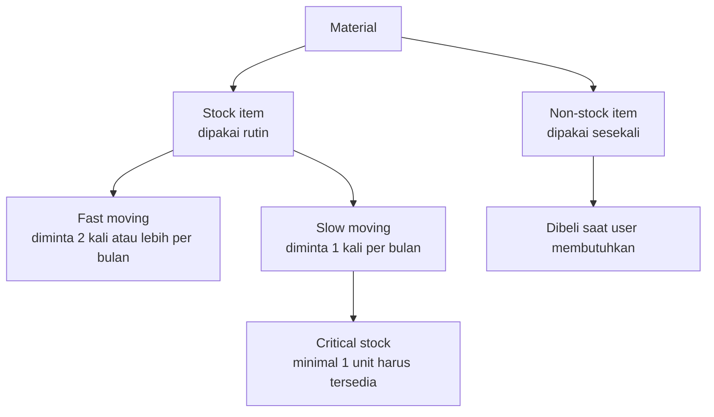

# Manajemen Inventory

Tidak semua material diperlakukan sama. Ada yang harus selalu tersedia, ada yang dibeli hanya saat dibutuhkan, dan ada yang jarang dipakai tetapi tidak boleh kosong.

## Stock item dan non-stock item

### Stock item

Material yang **sering dibutuhkan** user. Pemakaiannya diamati dalam periode tertentu, lalu dikelompokkan menjadi *fast moving* atau *slow moving*. Karena rutin dipakai, stoknya harus dijaga sesuai intensitas pemakaian. Untuk itu dihitung tiga angka:

- **Stok maksimum**: batas atas agar tidak menumpuk.
- **Stok minimum**: batas bawah agar tidak kehabisan.
- **ROP** (*Reorder Point*): titik saat material harus dipesan kembali.

Cara menghitungnya dijelaskan di tutorial [Menghitung Min, Maks & ROP](/tutorial/min-max-rop).

### Non-stock item

Material yang kebutuhannya **hanya sesekali** dan tidak rutin. Material ini tidak perlu disimpan sebagai stok dan baru dibeli ketika user membutuhkannya.

## Fast moving dan slow moving

Di gudang yang berada di dalam pabrik (*manufacturing plant warehouse*), kecepatan perputaran tiap material berbeda. Penentuannya menggunakan metode **cycle counting**:

| Kategori | Ciri | Kriteria |
| --- | --- | --- |
| **Fast moving** | Sering dipakai, perputarannya cepat | Diminta atau direservasi **2 kali atau lebih** dalam sebulan |
| **Slow moving** | Jarang dipakai, perputarannya lambat | Diminta atau direservasi **1 kali** dalam sebulan |

::: info Belum tercakup
Materi presentasi belum menjelaskan kategori untuk material yang tidak diminta sama sekali dalam sebulan. Tanyakan ke pembimbing apakah material seperti itu dihitung slow moving, atau diperiksa sebagai calon dead stock.
:::

Latihan mengklasifikasikan material ada di tutorial [Menentukan Fast & Slow Moving](/tutorial/fast-slow-moving).

## Critical spare part

### Critical stock

Material yang termasuk *slow moving*, tetapi **harus ada** jika sewaktu-waktu dibutuhkan user. Stok minimumnya **1 unit** untuk menutup permintaan mendadak. Contoh umumnya adalah suku cadang mesin yang jarang rusak, tetapi jika rusak dan tidak tersedia, mesin akan berhenti lama.

### Dead stock

Persediaan yang **sudah tidak dipakai lagi**. Penyebabnya antara lain:

1. **Kesalahan prediksi**
   - Umur pakai produk lebih pendek dari rencana.
   - Pemakaian user tidak sebanyak yang direncanakan.
   - Pengendalian stok kurang baik, misalnya menurut data stok habis tetapi barangnya ternyata masih ada.
   - Saat memesan barang, posisi stok sebenarnya tidak diperhatikan.
   - Mesin sudah tidak dipakai atau sudah dimodifikasi, sehingga suku cadangnya tidak terpakai.
   - Barang yang dipesan salah atau tidak sesuai spesifikasi.
2. **Barang kedaluwarsa**
   - *Overstock*: terlalu lama disimpan sehingga mutunya turun.
   - Sistem FIFO belum diterapkan dengan benar.

Cara umum menangani dead stock dibahas di [SOP Dead Stock & Barang Rusak](/sop/dead-stock).
