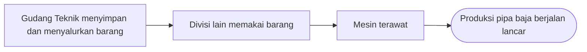

# Profil Perusahaan

Kenalan dulu dengan tempat kamu magang: PT Bakrie Pipe Industries, atau biasa disingkat BPI.

<ProfilTabel :kunci="['namaResmi', 'singkatan', 'bidangUsaha', 'lokasiPabrik', 'grup']" />

## Apa yang dikerjakan perusahaan?

<ProfilBagian kunci="kegiatanUsaha" />

::: details Istilah: pipa ERW dan coating
**Pipa baja ERW** (*Electric Resistance Welding*) dibuat dari lembaran baja yang digulung jadi tabung. Kedua tepinya dipanaskan dengan arus listrik lalu ditekan sampai menyatu, tanpa kawat las tambahan.

**Coating** adalah lapisan pelindung di permukaan pipa supaya tidak berkarat.
:::

## Nilai kerja

<ProfilBagian kunci="nilaiPerusahaan" bentuk="label" />

## Apa hubungannya dengan Gudang Teknik?

Pabrik pipa baja butuh mesin yang selalu siap jalan. Mesin perlu dirawat, dan perawatan butuh spare part, alat kerja, bahan habis pakai, serta APD. Semua barang itu disimpan dan disalurkan oleh **Gudang Teknik**.

Jadi, kesalahan kecil di gudang bisa berdampak besar. Contohnya salah ambil ukuran bearing, atau stok tercatat ada padahal kosong. Kalau itu terjadi, perbaikan mesin bisa tertunda.

::: info Akan dilengkapi
Visi, misi, dan sejarah perusahaan akan ditambahkan setelah dikonfirmasi pembimbing.
:::

## Sumber informasi

- [Management Presentation Bakrie & Brothers, September 2020](https://bakrie-brothers.com/wp-content/uploads/2020/12/ENG2020112316061150613466.pdf)
- [Laporan Tahunan Bakrie & Brothers 2013](https://bakrie-brothers.com/wp-content/uploads/2020/12/ENG2020042015873633067193.pdf)
- [detikFinance, 25 Januari 2024](https://finance.detik.com/foto-bisnis/d-7160378/wamendag-jerry-sambuaga-kunjungi-pabrik-industri-pipa-nasional)
- [Republika, 21 Mei 2015](https://ekonomi.republika.co.id/berita/nop4xn/menperin-resmikan-pt-bakrie-pipe-industries)
- Presentasi internal Gudang Teknik

Daftar lengkapnya ada di [Sumber Informasi](/referensi).
