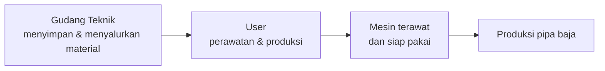

# Profil PT Bakrie Pipe Industries

Gambaran singkat perusahaan tempat Anda magang. Setiap fakta diberi nomor sumber, misalnya [1]. Klik nomornya untuk melihat asal informasi tersebut.

## Ringkasan

<ProfilTabel :kunci="['namaResmi', 'singkatan', 'bidangUsaha', 'industri', 'lokasiPabrik', 'grup', 'tahunBerdiri']" />

## Kegiatan usaha

<ProfilBagian kunci="kegiatanUsaha" />

### Istilah yang perlu dipahami

**Pipa baja las ERW** (*Electric Resistance Welding*) dibuat dari lembaran baja yang digulung membentuk tabung. Kedua tepi lembaran lalu dipanaskan dengan arus listrik frekuensi tinggi dan ditekan hingga menyatu, tanpa kawat las tambahan. Hasilnya adalah pipa dengan satu jalur sambungan memanjang.

**Coating** adalah lapisan pelindung pada permukaan pipa, terutama untuk mencegah karat (korosi) saat pipa dipakai di tanah, air, atau lingkungan industri.

**Anak usaha** adalah perusahaan yang sebagian besar sahamnya dimiliki perusahaan lain (induk). Dalam hal ini, induknya adalah PT Bakrie & Brothers Tbk.

## Produk dan layanan

<ProfilBagian kunci="produk" />

## Sejarah

<ProfilBagian kunci="sejarah" />

## Visi dan misi

### Visi

<ProfilBagian kunci="visi" />

### Misi

<ProfilBagian kunci="misi" />

## Nilai kerja

<ProfilBagian kunci="nilaiPerusahaan" bentuk="label" />

## Struktur organisasi

<ProfilBagian kunci="strukturOrganisasi" />

## Apa hubungannya dengan kegiatan magang saya?

Pabrik pipa baja bergantung pada mesin. Mesin perlu dirawat dan diperbaiki, dan perawatan itu membutuhkan suku cadang, alat kerja, bahan habis pakai, serta APD. Gudang Teknik adalah tempat semua barang tersebut diterima, disimpan, dicatat, lalu disalurkan ke pengguna yang membutuhkan.

Karena itu, kesalahan kecil di gudang bisa berdampak besar. Contohnya, salah mengambil ukuran bearing, stok yang tercatat ada padahal kosong, atau barang yang lama ditemukan. Semua itu dapat membuat perbaikan mesin tertunda. Prinsip **right material, right quantity, right condition, right time** dari materi Gudang Teknik menjelaskan hal ini. Baca lebih lanjut di [Pengenalan Gudang Teknik](/divisi/).

::: info Perlu dilengkapi
Nama bagian atau divisi yang menjadi user utama Gudang Teknik, misalnya bagian perawatan (*maintenance*) atau bagian produksi, belum dikonfirmasi. Mintalah daftar resminya kepada pembimbing.
:::
