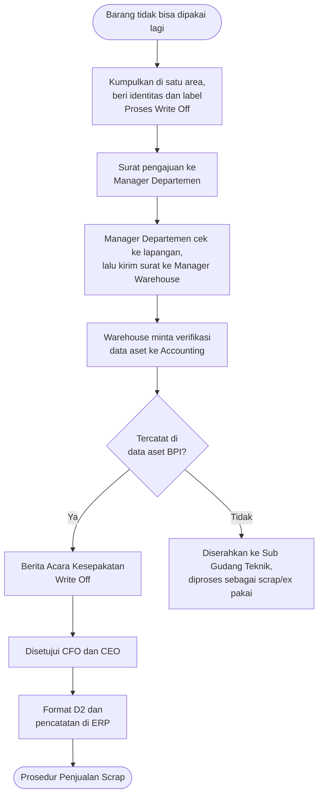

# SOP Write Off & Barang Rusak

Di BPI, <strong>write off</strong> berarti penghapusbukuan: catatan aset dihapus dari pembukuan perusahaan karena barangnya tidak bisa dipakai lagi. Halaman ini meringkas Prosedur Penghapusbukuan Aktiva Tetap (Write Off) No. QP-4.3.3 Rev. 0.

## Apa yang bisa di-write off?

Prosedur ini berlaku untuk **aktiva tetap BPI yang diperoleh melalui CAPEX**, yaitu:

- aktiva tetap yang tidak sesuai lagi untuk digunakan, atau
- barang bekas pakai (*ex pakai*) yang tidak bisa berfungsi lagi, karena rusak dan tidak bisa diperbaiki, atau karena suku cadangnya sudah tidak tersedia (*obsolete*).

| Istilah | Artinya |
|---|---|
| **Write off** | Penghapusbukuan, yaitu penghapusan catatan aktiva tetap dari pembukuan BPI. |
| **Aktiva tetap** | Aset berwujud milik BPI yang dibeli atau dibangun untuk dipakai dalam operasional perusahaan. |
| **CAPEX** | *Capital Expenditure* (pembelanjaan modal), yaitu anggaran untuk memperoleh, menambah kapasitas, mengefisienkan, atau memperpanjang umur aktiva tetap. |

## Peran

| Peran | Tanggung jawab |
|---|---|
| **Pengguna (Supervisor) / pemilik barang** | Mengumpulkan dan mengenali barang, mengajukan surat write off ke Manager Departemen, memverifikasi ulang data barang fisik, dan menjaga barang sampai prosesnya selesai. |
| **Manager Departemen** | Memeriksa surat pengajuan dan mengecek barangnya ke lapangan, lalu membuat surat write off ke Manager Warehouse. |
| **Dept. Warehouse** | Meminta verifikasi data aset ke Dept. Accounting, meneruskan hasilnya ke pengguna, membuat Berita Acara Kesepakatan Write Off, lalu mengelola barang setelah berita acara terbit. |
| **Dept. Accounting** | Memverifikasi data aset perusahaan, termasuk nilai buku, berdasarkan nama dan spesifikasi barang. |
| **COO / CHRA / Senior Manager IT & System, bersama Chief Logistic** | Membuat Berita Acara Kesepakatan Write Off. |
| **CFO dan CEO** | Menyetujui berita acara, dengan rekomendasi dijual, dimusnahkan, atau tindakan lain. |

## Alur write off

## Langkah-langkah

1. **Identifikasi barang.**
   - Kumpulkan barang yang akan diajukan di satu lokasi atau area tertentu.
   - Beri identitas pada barang: nama, spesifikasi, jumlah, dan lokasi asal penggunaan atau pemilik barang.
   - Beri tanda bertuliskan **"Proses Write Off"**, dan jaga barangnya sampai proses selesai.
2. **Ajukan surat write off.**
   - Pengguna atau pemilik barang mengirim surat pengajuan ke Manager Departemen. Surat ini bernomor dan berisi nama dan spesifikasi barang, lokasi asal, jumlah atau panjang dan berat, foto barang, serta keterangan pengajuan.
   - Manager Departemen memeriksa surat dan mengecek barangnya di lokasi.
   - Manager Departemen membuat surat write off bernomor ke Manager Warehouse, dengan melampirkan surat pengajuan dari pengguna.
3. **Verifikasi data aset.**
   - Dept. Warehouse meminta Dept. Accounting memverifikasi data barang, termasuk nilai bukunya.
   - Hasilnya diberikan ke pengguna untuk dicocokkan ulang dengan barang fisik.
   - Kalau nama dan spesifikasi barang **tercantum** di data aset, barang masuk ke Berita Acara Kesepakatan Write Off dan dilokalisir di area tertentu.
   - Kalau **tidak tercantum**, barang bisa langsung diserahkan ke Sub Gudang Teknik (Dept. Warehouse) dan diproses sesuai prosedur barang scrap atau ex pakai.
4. **Buat dan setujui berita acara.**
   - COO, CHRA, atau Senior Manager IT & System, bersama Chief Logistic, membuat Berita Acara Kesepakatan Write Off. Isinya: nama, spesifikasi, jumlah, satuan, atau berat barang, lokasi penggunaan, alasan pengajuan, dan perkiraan nilai barang.
   - CFO dan CEO menyetujuinya, dengan rekomendasi dijual, dimusnahkan, atau tindakan lain.
   - Manager Warehouse mendokumentasikan berita acara yang sudah disetujui, lalu membagikannya ke Manager Departemen, Manager Accounting, COO, Chief Logistic, CHRA, Senior Manager IT, CFO, dan CEO.
5. **Kelola barang setelah disetujui.**
   - Sub Gudang Teknik membuat **format D2** dan menyerahkannya ke petugas pengelola data scrap, supaya barang dicatat di ERP.
   - Selanjutnya barang dikelola sesuai Prosedur Penjualan Scrap.

## Dokumen dan penomoran surat

Semua nomor surat diawali `WO - BPI` (Write Off, PT Bakrie Pipe Industries), diikuti inisial, nomor surat, bulan (angka Romawi), dan tahun.

| Dokumen | Dari → kepada | Format nomor | Contoh |
|---|---|---|---|
| Surat pengajuan write off | Pengguna/pemilik → Manager Departemen | `WO - BPI / [inisial sub departemen] - [no.] / [bulan] / [tahun]` | `WO - BPI / MTN Utility - 002 / V / 2016` |
| Surat pengajuan write off | Manager Departemen → Manager Warehouse | `WO - BPI / [inisial departemen] - [no.] / [bulan] / [tahun]` | `WO - BPI / MTN - 002 / V / 2016` |
| Berita Acara Kesepakatan Write Off | Chief terkait dan Chief Logistic → CFO dan CEO | `WO - BPI / [COO/CHRA/...] - CLOG - [no.] / [bulan] / [tahun]` | `WO - BPI / COO - CLOG - 002 / V / 2016` |

## Kalau kamu menemukan barang rusak atau tidak terpakai

Keputusan write off, penjualan, atau pemusnahan **bukan** wewenang peserta magang. Yang bisa kamu lakukan:

1. Kenali tanda-tandanya: barang rusak, melewati tanggal kedaluwarsa, untuk mesin yang sudah tidak dipakai, atau lama tidak ada permintaan.
2. Pisahkan barang dari stok layak pakai dan beri tanda yang jelas, misalnya "Tidak untuk dikeluarkan".
3. Catat kode, nama, jumlah, kondisi, lokasi asal, dan perkiraan penyebabnya.
4. Laporkan ke pembimbing, lalu ikuti keputusan pihak yang berwenang.

Material **baru** yang datang dari vendor tetapi tidak sesuai spesifikasi tidak masuk proses write off. Material itu diberi tanda **Material Reject** dan diklaim ke vendor. Lihat [SOP Penerimaan Barang](./penerimaan-barang#kalau-material-tidak-sesuai).

## Perhatian keselamatan

::: warning Barang rusak bisa berbahaya
- Consumable yang bocor atau kedaluwarsa, seperti oli, grease, dan sealant, ditangani dengan sarung tangan dan tidak dibuang sembarangan. Ikuti aturan limbah perusahaan.
- Barang tajam atau pecah dibungkus agar tidak melukai orang lain.
:::

## Pencegahan

- Jalankan FIFO dan FEFO dengan disiplin.
- Cek posisi stok sebenarnya sebelum mengajukan pembelian.
- Laporkan jika mesin yang dilayani sudah tidak dipakai atau sudah dimodifikasi, agar suku cadangnya dievaluasi.

## Acuan

QAM-1 Quality Assurance Manual BPI, HSE-M-1 HSE Manual BPI, ISO 9001:2008, OHSAS 18001:2007, dan ISO 14001:2014.
