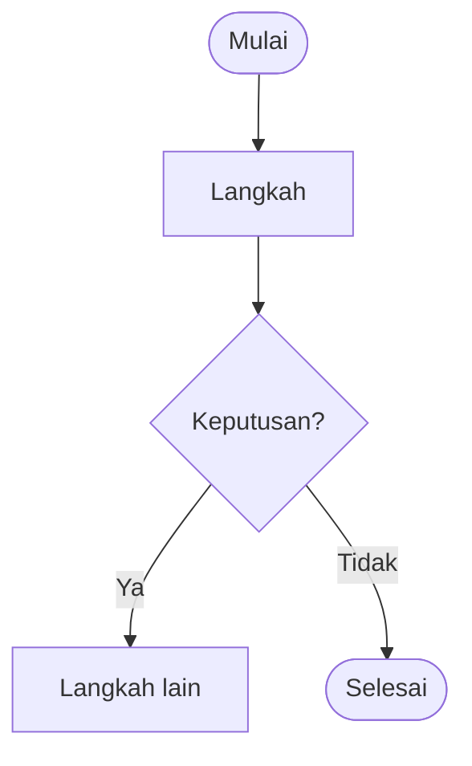

# Cara Memperbarui Handbook

<p class="lead">Semua isi handbook ada di file teks biasa: Markdown untuk artikel dan JSON untuk data. Kamu tidak perlu mengubah kode tampilan untuk memperbarui isi.</p>

## Di mana isi disimpan

| Yang ingin diubah | File |
| --- | --- |
| Artikel, tutorial, SOP | `docs/<folder>/<nama-halaman>.md` |
| Menu atas dan sidebar | `docs/data/navigasi.json` |
| Isi Beranda | `docs/data/beranda.json` |
| FAQ | `docs/data/faq.json` |
| Langkah alur barang masuk & keluar | `docs/data/alur.json` |
| Profil perusahaan | `docs/data/company-profile.json` |
| Daftar sumber | `docs/data/sumber.json` |
| Kelompok material | `docs/data/material.json` |
| Arti label status | `docs/data/status.json` |
| Gambar | `docs/public/images/` |
| Warna tema | `docs/.vitepress/theme/custom.css` (bagian `:root`) |

## Menambah halaman baru

1. Buat file `.md` di folder yang sesuai, misalnya `docs/sop/pengembalian-barang.md`.
2. Isi bagian atas file (frontmatter) seperti contoh berikut:

```yaml
---
title: SOP Pengembalian Barang
description: Ringkasan satu kalimat tentang isi halaman.
status: draf            # draf | ditinjau | disetujui | terverifikasi | perlu-verifikasi
dasar: praktik umum pergudangan   # dari mana isinya disusun
diperbarui: 2026-10-20
kategori: SOP
sumber: [ppt-gudang-teknik]       # id dari docs/data/sumber.json
kata_kunci: [pengembalian, retur internal]
---
```

3. Tulis isinya di bawah frontmatter, dimulai dengan satu judul `# ...`.
4. Daftarkan halaman di `docs/data/navigasi.json` agar muncul di sidebar. Tulis tautan tanpa `.md`, misalnya `/sop/pengembalian-barang`.

Untuk SOP, isi juga `nomor_dokumen`, `versi`, `pemilik`, dan `pengesah` di frontmatter (tidak ditampilkan, untuk catatan pengelola).

Catatan kecil di atas judul hanya muncul untuk status `draf` dan `perlu-verifikasi`. Tulis `catatan: Teks bebas` di frontmatter untuk mengganti teksnya, atau `catatan: false` untuk menyembunyikannya.

## Memperbarui FAQ

Buka `docs/data/faq.json`, lalu tambahkan objek di dalam `pertanyaan` pada kategori yang sesuai:

```json
{
  "id": "contoh-pertanyaan-baru",
  "tanya": "Pertanyaannya?",
  "jawab": "Jawabannya. Boleh memakai **tebal** dan [tautan](/sop/).",
  "status": "terjawab"
}
```

Jika belum ada jawaban resmi, isi `"jawab": ""` dan `"status": "menunggu-pembimbing"`. Pertanyaan seperti itu **tidak tampil** di website sampai jawabannya diisi dan statusnya diubah menjadi `terjawab`. FAQ yang tampil otomatis masuk ke pencarian.

## Memperbarui profil perusahaan

1. Tambahkan sumbernya di `docs/data/sumber.json`, lengkap dengan `id`, `judul`, `penerbit`, `url`, `tanggalTerbit`, dan `tanggalAkses`.
2. Di `docs/data/company-profile.json`, isi `nilai` pada bagian yang sesuai, misalnya `visi`.
3. Ubah `status` bagian itu menjadi `terverifikasi`, lalu isi `sumber` dengan `id` dari langkah 1.

Bagian berstatus `perlu-verifikasi` tidak akan tampil sebagai fakta, walaupun `nilai`-nya sudah diisi. Jangan mengisi visi, misi, sejarah, atau angka bisnis tanpa sumber.

## Mengganti gambar

1. Simpan gambar di `docs/public/images/`. Gunakan nama file huruf kecil tanpa spasi, misalnya `label-rak-a.jpg`.
2. Kecilkan ukuran file lebih dulu, idealnya di bawah 300 KB, dengan lebar sekitar 1600 px.
3. Panggil di Markdown: ``.
4. Tulis deskripsi (alt text) yang menjelaskan isi gambar, bukan sekadar "gambar 1".

**Logo perusahaan:** simpan file logo resmi sebagai `docs/public/images/logo-perusahaan.svg` (atau `.png`). Logo akan muncul otomatis di header setelah build ulang.

::: warning Semua file di folder public bisa diakses siapa saja
File di `docs/public/` ikut terunggah dan bisa dibuka langsung lewat alamatnya, walaupun tidak ditautkan dari halaman mana pun. Jangan menaruh dokumen internal, foto sistem, atau data pribadi di sana tanpa izin.
:::

## Mengubah alur barang masuk / keluar

Alur ditampilkan dua kali: sebagai **flowchart** dan sebagai **daftar langkah**.

1. **Daftar langkah**: ubah `docs/data/alur.json`. Setiap langkah berisi `aktor` (`vendor`, `staff`, `sistem`, `divisi`, `dokumen`), `judul`, `teks`, dan `cek` jika langkah itu berupa pengecekan Ya/Tidak.
2. **Flowchart**: ubah blok `mermaid` di `docs/alur-kerja/barang-masuk.md`, `barang-keluar.md`, atau `index.md` (flowchart lengkap).

Pastikan keduanya tetap sama urutannya.

## Menambah diagram

Tulis diagram Mermaid di dalam blok kode bertanda `mermaid`:

````md

````

- Gunakan `flowchart TD` (atas ke bawah) agar diagram tetap terbaca di ponsel.
- Beri warna sesuai pelaku dengan menambahkan kelas di belakang kotak: `:::vendor`, `:::staff`, `:::divisi`, `:::sistem`, `:::dokumen`, `:::cek` (pengecekan), `:::tolak` (dikembalikan), atau `:::selesai`. Contoh: `A["Staff menerima barang"]:::staff`. Warnanya diatur di `docs/.vitepress/theme/warnaAlur.ts`.
- Tulis teks kotak di dalam tanda kutip, misalnya `B{"Sesuai pesanan?"}`, supaya tanda seperti `/` tidak merusak diagram.
- Selalu tulis `accTitle` dan `accDescr`.
- Sertakan juga versi tertulis langkah-langkahnya di bawah diagram.

## Menyetujui halaman dan SOP

Setelah pembimbing memeriksa sebuah halaman, ubah `status` di frontmatter menjadi `disetujui`. Untuk SOP, isi juga `nomor_dokumen`, `versi`, dan `pengesah`. Jika perusahaan punya SOP resmi, cantumkan judul dan nomornya di bagian **Baca juga**, tetapi jangan mengunggah file SOP resmi ke folder publik tanpa izin.

Jalankan `npm run cek-publikasi` untuk melihat rekap status semua halaman.
