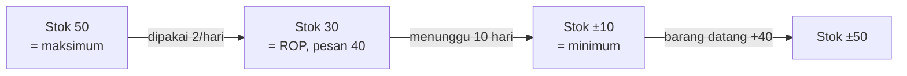

# Menghitung Min, Maks & ROP

Stock item perlu batas bawah, batas atas, dan titik kapan harus dipesan ulang. Tutorial ini memakai rumus umum yang banyak dipakai di pergudangan.

::: tip Sebelum mulai
- **Setelah latihan ini, kamu bisa** menghitung stok minimum, stok maksimum, dan ROP untuk satu material.
- **Tingkat:** Menengah, sekitar 30 menit.
- **Baca dulu:** [Menentukan Fast & Slow Moving](/tutorial/fast-slow-moving).
- **Siapkan:** data pemakaian beberapa bulan terakhir, lead time pemesanan, kalkulator.
:::

## Istilah dan rumus

| Simbol | Arti | Rumus |
| --- | --- | --- |
| **d** | Pemakaian rata-rata per hari kerja | total pemakaian ÷ jumlah hari kerja |
| **L** | Lead time: hari dari pemesanan sampai barang tiba | dari data pembelian |
| **SS** | Safety stock (stok pengaman) | d × jumlah hari cadangan |
| **ROP** | Titik pemesanan ulang | (d × L) + SS |
| **Min** | Stok minimum | SS |
| **Q** | Jumlah sekali pesan | ditentukan gudang, misalnya mengikuti kemasan |
| **Maks** | Stok maksimum | SS + Q |

::: info Konvensi bisa berbeda
Sebagian gudang menetapkan stok minimum sama dengan ROP, atau menghitung stok maksimum dengan cara lain. Pakai definisi yang berlaku di Gudang Teknik jika berbeda. Untuk **critical stock**, materi Gudang Teknik menetapkan stok minimum 1 unit.
:::

## Langkah dengan data latihan

Material latihan: `CTH-PPE-007` Sarung tangan kerja (fast moving).

1. **Hitung pemakaian rata-rata per hari kerja.**
   Total pemakaian 3 bulan adalah 132 pasang, dengan 66 hari kerja.
   d = 132 ÷ 66 = **2 pasang/hari**
2. **Tentukan lead time.** Dari data pembelian, barang biasanya tiba **10 hari kerja** setelah dipesan. L = 10.
3. **Hitung safety stock.** Gudang ingin cadangan untuk **5 hari** jika pengiriman terlambat.
   SS = 2 × 5 = **10 pasang**
4. **Hitung ROP.**
   ROP = (2 × 10) + 10 = **30 pasang**
5. **Tetapkan stok minimum.** Min = SS = **10 pasang**
6. **Tetapkan jumlah sekali pesan.** Misalnya **40 pasang**, sesuai kemasan dari supplier.
7. **Hitung stok maksimum.** Maks = 10 + 40 = **50 pasang**

## Membaca hasilnya

Saat stok turun ke **30**, gudang memesan **40**. Selama 10 hari menunggu, terpakai sekitar 20, sehingga stok tersisa sekitar **10** (stok pengaman) saat barang datang. Setelah barang diterima, stok kembali sekitar **50** (stok maksimum).

## Kesalahan umum

- Memakai hari kalender padahal pemakaian hanya terjadi di hari kerja, atau sebaliknya.
- Lupa memperbarui angka saat pola pemakaian berubah, misalnya mesin baru dipasang.
- Memakai lead time terlalu optimistis sehingga stok habis sebelum barang datang.

## Hasil yang diharapkan

Kamu bisa menghitung d, SS, ROP, stok minimum, dan stok maksimum untuk satu material, serta menjelaskan arti setiap angka kepada pembimbing.
